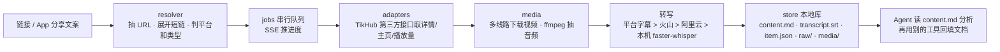

# 拾取 · Glean

> **一句话部署**：把这个仓库链接 https://github.com/ijijEas0n/glean 发给你的 Agent（Grok Bot / Claude Code / Codex 等），说「按 AGENTS.md 帮我部署 glean」。

把互联网上的内容「拿下来」：粘一个链接 → 抓到全部内容（含视频语音转写）→ 本地网页里查看 → 规整地存进本地库，给 AI Agent 直接读。

**只做一件事**：抓取与入库。不做分析、不做改写、不做发布——分析交给 Agent，回填（如飞书文档）交给 Agent 的其他工具。

当前重点支持 **抖音、小红书**（单条作品 + 博主主页）；推特/B 站/YouTube 等适配器代码保留，但未作完整验收。

## 架构



关键设计：
- **链接解析防脏输入**：从分享文案里抽 URL，跟随 302 展开短链（`v.douyin.com`、`xhslink.com`），`user/<id>?modal_id=<作品id>` 识别为单条作品。
- **不自己维护 cookie / 登录态**：数据走 [TikHub](https://tikhub.io) 聚合接口（付费）。本机直连被拦时会自动探测本地代理端口。
- **播放量**：抖音详情接口的 `play_count` 恒为 0，改用批量统计接口（一次 50 条）收尾补齐；取不到不影响整次抓取。
- **转写不静默降级**：实际用了哪个引擎写进 `transcript.source` 与 `warnings`。
- **为 Agent 设计输出**：每条一个目录，`content.md` 带 YAML 头 + 正文 + 标签 + 字幕；`raw/` 保留接口原始返回以便溯源；原文不改写。
- **零 pip 依赖**：仅 Python 3.11+ 标准库 + `ffmpeg` / `yt-dlp` 命令行。

## 安装

```bash
brew install python ffmpeg yt-dlp      # macOS；Linux 用对应包管理器
git clone https://github.com/ijijEas0n/glean.git && cd glean
cp .env.example .env                   # 填入你的 key
./启动.sh                               # 后台启动 → http://127.0.0.1:8899
./启动.sh --foreground                  # 前台调试
./停止.sh
```

macOS 想开机自启、崩溃自动拉起：`./安装自启.sh`（launchd，标识 `com.example.glean`，可在脚本里改），卸载 `./卸载自启.sh`。

## 配置（环境变量）

仓库里不存任何密钥。读取顺序：**环境变量 → `~/.glean/config.json`**（网页「设置」面板填写，权限 600）。

| 变量 | 用途 | 必需 |
|---|---|---|
| `TIKHUB_API_KEY` | TikHub 接口，抓取作品/主页/播放量 | ✅ |
| `VOLCENGINE_ASR_API_KEY` | 火山引擎「大模型录音文件极速版」转写（默认引擎，快） | 二选一 |
| `DASHSCOPE_API_KEY` | 阿里云百炼异步文件转写（分句更整，支持长音频） | 二选一 |
| `GLEAN_WHISPER_PYTHON` | 装了 `faster-whisper` 的 Python 解释器路径，作本机兜底（慢、免费） | 可选 |
| `GLEAN_LIBRARY_DIR` | 本地库目录，默认 `./library` | 可选 |
| `GLEAN_CONFIG_DIR` | 配置目录，默认 `~/.glean` | 可选 |
| `GLEAN_WHISPER_MODEL` | 本机 whisper 模型（`base`/`small`/`medium`，默认 `small`） | 可选 |
| `GLEAN_PYTHON` | 启动脚本使用的 Python，默认 `python3` | 可选 |

本机 whisper 兜底：
```bash
python3 -m venv ~/.glean/faster-whisper && ~/.glean/faster-whisper/bin/pip install faster-whisper
```
（放在这个默认位置可自动发现，否则设 `GLEAN_WHISPER_PYTHON`。）

转写引擎在网页首页开关或 `~/.glean/config.json` 的 `transcribe_engine`（`volcengine|aliyun|local|off`）切换。

## 本地库结构

```
library/
├── AGENTS.md / index.json / index.md
└── items/<platform-kind-id>/
    ├── content.md      # ★ Agent 优先读
    ├── transcript.srt  # 有字幕才有
    ├── item.json       # 结构化完整记录
    ├── raw/            # 接口原始返回
    └── media/          # 封面、图片、视频
```

## 接入 Agent

服务是本机 HTTP API，Agent 用 `curl` 即可：

| 接口 | 作用 |
|---|---|
| `GET /api/status` | 健康检查 |
| `POST /api/resolve` `{"url": ...}` | 识别链接 + 查重（返回 `already_in_library`） |
| `POST /api/jobs` `{"url": ..., "options": {"download_media": true, "transcribe": true}}` | 提交抓取，返回 `job_id` |
| `GET /api/jobs/<job_id>` | 轮询状态：`done` / `partial` / `failed` |
| `POST /api/preview` `{"url": <主页>, "options": {"limit": 50}}` | 博主主页先预览作品清单 |

示例 Skill 见 [`examples/SKILL.md`](examples/SKILL.md)。抓下来后，让 Agent 读 `library/items/<id>/content.md` 做分析；需要回填到飞书等文档时，用对应平台的 CLI / Skill 单独完成（本项目不包含）。

## 已移除

开源版不包含任何需要登录态 / cookie 或客户端解密的抓取能力。

## 免责声明

仅供个人学习与研究。请遵守各平台服务条款与著作权法，抓取内容勿用于再分发或商业用途。

## License

MIT © 2026 迅仔
