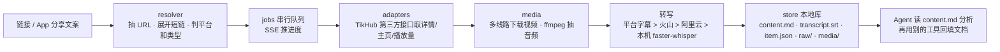

# 拾取 · Glean

> **一句话部署**：把这个仓库链接 https://github.com/ijijEas0n/glean 发给你的 Agent（Grok Bot / Claude Code / Codex 等），说「按 AGENTS.md 帮我部署 glean」。

**正常抓取并且转写**，需要两样东西：TikHub Key，再加上一种转写方式——火山引擎「大模型录音文件极速版」、阿里云百炼 DashScope（**北京**地域），或本机 faster-whisper。三者有一种即可。Key 自己写入 `.env` 或网页设置，**不要贴进聊天**。

把互联网上的内容「拿下来」：粘一个链接 → 抓到全部内容（含视频语音转写）→ 本地网页里查看 → 规整地存进本地库，给 AI Agent 直接读。

**只做一件事**：抓取与入库。不做分析、不做改写、不做发布——分析交给 Agent，回填（如飞书文档）交给 Agent 的其他工具。

当前重点支持 **抖音、小红书**（单条作品 + 博主主页）；推特/B 站/YouTube 等适配器代码保留，但未作完整验收。

服务进程起来，还不等于端到端通过。验收标准见下面的「怎样才算通过」。

## 架构



关键设计：
- **链接解析防脏输入**：从分享文案里抽 URL，跟随 302 展开短链（`v.douyin.com`、`xhslink.com`），`user/<id>?modal_id=<作品id>` 识别为单条作品。
- **不自己维护 cookie / 登录态**：数据走 [TikHub](https://tikhub.io) 聚合接口（付费）。本机直连被拦时会自动探测本地代理端口。
- **播放量**：抖音详情接口的 `play_count` 恒为 0，改用批量统计接口（一次 50 条）收尾补齐；取不到不影响整次抓取。
- **转写不静默降级**：实际用了哪个引擎写进 `transcript.source` 与 `warnings`。
- **为 Agent 设计输出**：每条一个目录，`content.md` 带 YAML 头 + 正文 + 标签 + 字幕；`raw/` 保留接口原始返回以便溯源；原文不改写。
- **零 pip 依赖**：仅 Python 3.11+ 标准库 + `ffmpeg` / `yt-dlp` 命令行。

## 配置

仓库里不存任何密钥。公开包也不会附带 Key。

写到哪里（两处都行，**环境变量优先**）：

1. 复制 `.env.example` 为 `.env`，用编辑器自己粘贴后保存。`./启动.sh` 会加载它。`.env` 已在 `.gitignore`。
2. 服务起来之后，在网页「设置」里填。写入 `~/.glean/config.json`（权限 600，目录可用 `GLEAN_CONFIG_DIR` 改）。

**不要把 Key 贴进聊天、Issue 或 PR。** Agent 只检查某一行是否非空，不读、不打印值。`/api/status` 里的 `key_present: true` 只表示读到了 TikHub 配置，不表示鉴权或余额已经通过。

| 名称 | 用途 | 何时必需 | 写到哪里 |
|---|---|---|---|
| `TIKHUB_API_KEY` | 抓取抖音、小红书作品 / 主页 / 播放量 | **抓取必需** | `.env`，或网页设置 |
| `VOLCENGINE_ASR_API_KEY` | 火山「大模型录音文件极速版」（默认引擎，快） | 选择火山转写时必需 | `.env`，或网页设置 |
| `DASHSCOPE_API_KEY` | 阿里云百炼异步文件转写。必须是**华北 2（北京）**的 Key | 选择阿里云转写时必需 | `.env`，或网页设置 |
| 本机 faster-whisper | 不花钱的转写，较慢。不需要云转写 Key | 选择本机转写时要装好 | 可选 `GLEAN_WHISPER_PYTHON`；默认路径会自动发现 |
| `GLEAN_WHISPER_MODEL` | 本机模型：`base` / `small` / `medium`，默认 `small` | 可选 | `.env` |
| `GLEAN_LIBRARY_DIR` | 本地库目录，默认 `./library` | 可选 | `.env` |
| `GLEAN_CONFIG_DIR` | 配置目录，默认 `~/.glean` | 可选 | `.env` |
| `GLEAN_PYTHON` | 启动脚本使用的 Python，默认 `python3`（需 3.11+） | 可选 | `.env` |

云转写的两个 Key **按所选引擎填一个即可**，不是「两个都要」，也不是「填了任意一个就等于转写可用」。引擎在网页上切换，或写在配置里的 `transcribe_engine`（`volcengine` | `aliyun` | `local` | `off`）。

只抓文案、不转写：把引擎设为 `off`，可以不配转写 Key。这样不能算「有人声字幕」通过。

本机 whisper：

```bash
python3 -m venv ~/.glean/faster-whisper && ~/.glean/faster-whisper/bin/pip install faster-whisper
```

放在这个默认位置可自动发现，否则设 `GLEAN_WHISPER_PYTHON`。

## 怎样才算通过

| 层级 | 意思 |
|---|---|
| 服务启动 | `GET /api/status` 的 `ok` 为 `true`。只说明进程在听 `127.0.0.1:8899` |
| 端到端通过 | 打开转写后再抓一条**有人声**的视频，`content.md` 里有「## 字幕原文」并且这一节有正文 |

`GET /api/jobs/<job_id>` 的任务字段是 **`job.state`**（不是 `status`）：

- `done`：结束，且没有 warnings。
- `partial`：结束，但带有 warnings。文件可能已经入库。
- `failed`：没有完成。

请求转写的视频若没有有效文字，任务会带原因并以 `partial` 结束（包括引擎 `off`、缺 Key、下载或转写失败）。主动选择 `transcribe: false` 不作字幕验收。网页提醒和详情会展示原因。

主页批量把子条警告汇总到任务 `warnings`，子条带 `item_id`、`has_transcript`；入库成功数不代表字幕成功数。验字幕需按子条 `item_id` 逐条检查 `content.md`，主页清单本身没有视频字幕。

**纯 BGM、没有人声**时，没有字幕正文、任务停在 `partial`，是正常结果，不要当成故障重抓。它也不能用来声称「转写验收通过」。

有人声样例若 `content.md` 没有字幕正文，验收不通过，即使任务不是 `failed`。更细的对照：`item.json` 里 `transcript.text` 非空、`segments` 非空、`transcript.source` 不是 `none`。

## 已验证有人声样例

下面两条在本轮验收里确认有人声。平台删除、权限或接口变化后可能失效。真抓会消耗 TikHub 和转写额度。

- 抖音：https://www.douyin.com/video/7401819680706448675
- 小红书：https://www.xiaohongshu.com/explore/6aad453b00000000110339cb

用它们做端到端验收时，通过条件是对应 `library/items/<item_id>/content.md` 里有非空的字幕正文，而不是仅仅服务能打开。

## 安装

依赖：Python 3.11+、`ffmpeg`、`yt-dlp`。启动脚本另外需要 `curl` 和 `lsof`（确认服务、检查端口）。缺 `curl` 或 `lsof` 时 `./启动.sh` 会直接说明并退出。

### macOS

```bash
brew install python ffmpeg yt-dlp      # curl、lsof 一般随系统自带
git clone https://github.com/ijijEas0n/glean.git && cd glean
cp .env.example .env                   # 自己填 Key，不要贴到聊天里
./启动.sh                               # 手动后台启动 → http://127.0.0.1:8899
./启动.sh --foreground                  # 前台调试
./停止.sh
```

开机自启、崩溃拉起：`./安装自启.sh`（**macOS launchd**，标识 `com.example.glean`，可在脚本里改），卸载 `./卸载自启.sh`。这套模板不能在 Linux 上当自启用。

### Linux

以 Ubuntu 24.04 / Debian 12、Python 3.11+ 为例。用 `pipx` 装 `yt-dlp`，避免往系统 Python 里 `pip install --user`。

```bash
sudo apt-get update
sudo apt-get install -y python3 ffmpeg curl lsof pipx
pipx install yt-dlp
export PATH="$HOME/.local/bin:$PATH"

python3 --version
ffmpeg -version
yt-dlp --version

git clone https://github.com/ijijEas0n/glean.git && cd glean
cp .env.example .env                   # 自己填 Key，不要贴到聊天里
./启动.sh                               # 手动后台启动 → http://127.0.0.1:8899
./停止.sh
```

Linux 上的验收范围是手动执行 `./启动.sh` / `./启动.sh --foreground`。仓库没有提供 systemd 单元；若要开机自启，需要自己写 user service 去跑 `./启动.sh --foreground`，这不在当前验收里。

## 本地库结构

```
library/
├── AGENTS.md / index.json / index.md
└── items/<platform-kind-id>/
    ├── content.md      # ★ Agent 优先读；字幕在「## 字幕原文」
    ├── transcript.srt  # 有字幕分段才有
    ├── item.json       # 结构化完整记录
    ├── raw/            # 接口原始返回
    └── media/          # 封面、图片、视频
```

`GLEAN_LIBRARY_DIR` 可以改掉这个目录。

## 接入 Agent

服务是本机 HTTP API。`127.0.0.1` 指**执行命令的那台机器**。云端 Agent 必须在跑 glean 的机器上执行，不能把自己的 localhost 当成用户的电脑。

| 接口 | 作用 |
|---|---|
| `GET /api/update` | 只读检查公开仓新版，提醒用户，不自动升级 |
| `GET /api/status` | 健康检查。`ok: true` 只表示服务已启动 |
| `POST /api/resolve` `{"url": ...}` | 识别链接 + 查重（返回 `already_in_library`） |
| `POST /api/jobs` `{"url": ..., "options": {"download_media": true, "transcribe": true}}` | 提交抓取，返回 `job_id` |
| `GET /api/jobs/<job_id>` | 轮询 `job.state`：`queued` / `running` / `done` / `partial` / `failed` |
| `POST /api/preview` `{"url": <主页>, "options": {"limit": 50}}` | 博主主页先预览作品清单 |

`examples/SKILL.md` 是模板，里面有 `<GLEAN_HOST>`、`<GLEAN_ROOT>` 等占位符，**不能原样复制给 Agent**。在仓库根目录生成可用副本：

```bash
python3 tools/render_skill.py \
  --host http://127.0.0.1:8899 \
  --root "$PWD" \
  --output ./generated/glean/SKILL.md
```

Agent 和 glean 不在同一台机器时加上 `--machine-label <机器名>`。库目录不是 `<仓库>/library` 时加上 `--library-dir`。已有输出默认不覆盖，确认要替换再加 `--force`。生成结果里不应再出现这些占位符。放到哪个 Skill 目录见 [`AGENTS.md`](AGENTS.md) 第 9 步。

抓下来后，让 Agent 读 `library/items/<id>/content.md` 做分析；需要回填到飞书等文档时，用对应平台的 CLI / Skill 单独完成（本项目不包含）。

## 检查更新与升级

`curl -s --max-time 5 http://127.0.0.1:8899/api/update` 返回当前版、最新版和更新链接。查不到更新不影响抓取。
版本号以根目录 `VERSION` 为准；修改后重启服务生效。

Agent 必须先征得用户同意，才可在 `<GLEAN_ROOT>` 执行 `git pull`，再按 [AGENTS.md](AGENTS.md) 重启服务（手动启动使用 `./停止.sh`、`./启动.sh`；已安装 launchd 自启的按其说明操作）。不会自动升级。

## 已移除

开源版不包含任何需要登录态 / cookie 或客户端解密的抓取能力。

## 免责声明

仅供个人学习与研究。请遵守各平台服务条款与著作权法，抓取内容勿用于再分发或商业用途。

## License

MIT © 2026 迅仔
