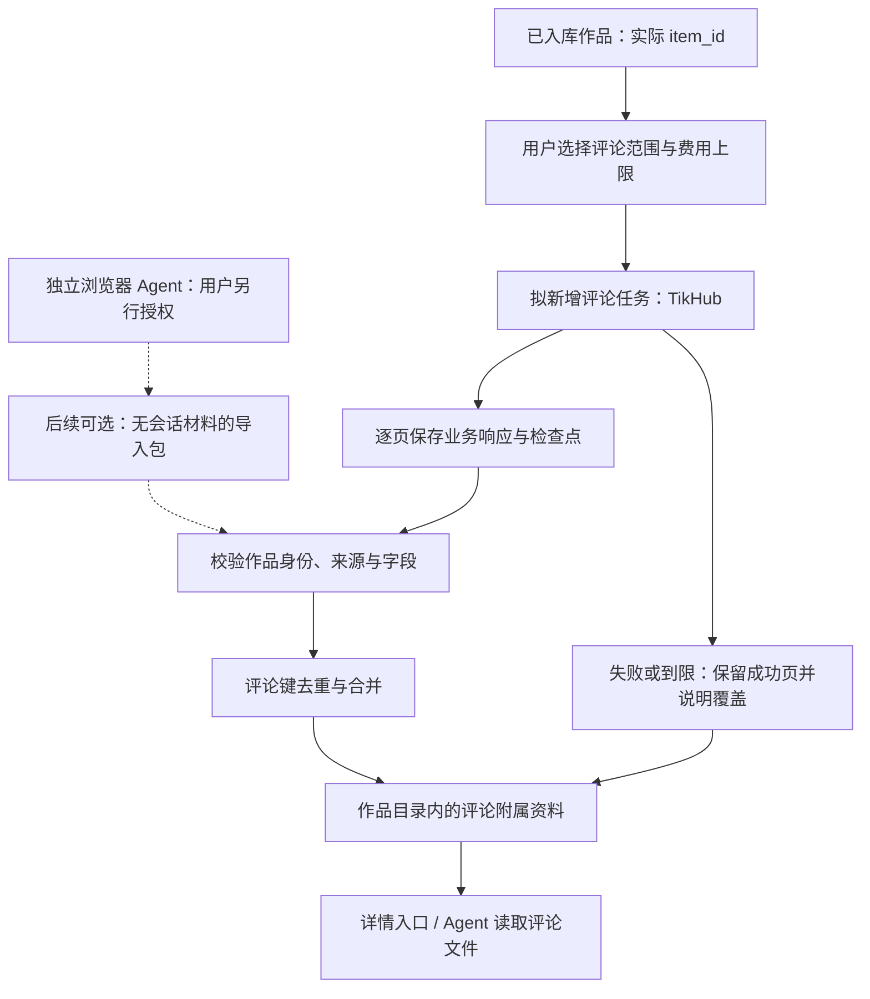
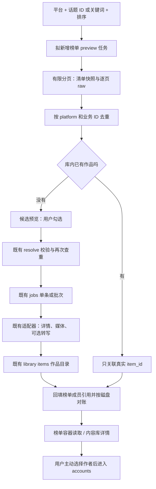

# 拾取 · 下一步功能方案：评论、话题爆款与体验

> 日期：2026-10-28。代码基准：main `949ef4b1e3f7dcdd27be78c0356c32a2666399a6`，版本 `1.0.0`，包含已合 PR #1 / #2 / #4 / #5 / #6。
> 现有功能盘点参考 [PR #7](https://github.com/ijijEas0n/glean/pull/7) 的 [功能总览](https://github.com/ijijEas0n/glean/blob/docs/feature-map/docs/功能总览.md)，读取时该分支 HEAD 为 `d13c564b443397051de68106d94864601a0b4b65`，尚未合入 main。
> **本文件仅为方案，未实现。** 下文标为“拟新增”的路径、字段和文件均不是当前功能。本轮只读仓库、GitHub 与公开文档，没有调用 TikHub 数据接口、云转写或下载真实媒体，也未连接、启停已有服务。公开文档有能力描述，不等于已验证权限、余额、数据完整性和稳定性。

建议先做 **抖音话题作品清单 → 挑选 → 去重入库**，再做 **显式启用的 TikHub 评论采集**；浏览器抓取先留为独立外挂实验。理由是话题清单更接近现有主页预览流程，又能直接回答“这个话题有哪些值得保存的视频”。评论可以补充受众材料，但需要先改变 SPEC 的内容范围。UI 只跟随这两条路径补必要反馈，整体改版后置。

## 1. 背景与现状缺口

### 1.1 已有能力与可复用部分

| 材料 / 代码 | 当前事实 | 对下一步的意义 |
|---|---|---|
| [README](../README.md)、[SPEC](../SPEC.md)、[VERSION](../VERSION) | 只做抓取与本地入库，重点抖音、小红书；不分析、改写、发布；服务默认 `127.0.0.1:8899` | 新功能保存来源材料，不内置爆款预测、评论情感分析或运营动作 |
| [部署剧本](../AGENTS.md)、[Skill 模板](../examples/SKILL.md) | 用户自行配置凭证；先 resolve 查重，主页先 preview 再 jobs；验收看文件 | 新能力需同步进入未来契约和生成后的 Skill，不能让现有模板误用尚未存在的接口 |
| [main](../server/main.py)、[resolver](../server/resolver.py) | `/api/resolve` 识别链接、按业务 ID 查已有；`/api/preview` 当前用于主页；没有评论、话题榜专用路由 | 不能直接把话题 URL 当成已经支持的主页预览，更不能让它静默走通用下载 |
| [jobs](../server/jobs.py)、[fetcher](../server/fetcher.py) | single / preview / batch，轮询 `job.state` 或 SSE；任务池默认两个 worker；任务在内存中 | 复用任务反馈与批量作品抓取；新增任务模式仍需开发。重启恢复和断点续跑目前不存在 |
| [适配器注册](../server/adapters/__init__.py)、[抖音](../server/adapters/douyin.py)、[小红书](../server/adapters/xiaohongshu.py) | 当前主平台端点用于详情、博主资料、作品列表、统计；未接评论和话题列表 | TikHub 有公开能力不等于 Glean 已接入；先限制这两个平台，不扩大其他适配器的可用承诺 |
| [tikhub](../server/tikhub.py) | 统一请求、代理、错误与重试；探测也可能联网 | 未来扩展走服务端适配器；本轮不导入运行模块，不触发探测 |
| [store](../server/store.py) | `items/` 是真源，`content.md` / `item.json` / raw / media；业务 ID 查重；索引可重建；已有来源与收藏分组合并逻辑 | 保存一份作品，多处关联；不能依赖可能失真的 `local` 缓存；评论分页 raw 需避免覆盖 |
| [网页](../web/app.js)、[页面](../web/index.html)、[样式](../web/style.css) | 收集、内容库、博主、设置、详情；勾选预览、只选没存的、缺文字、复制给 AI | 延续“先看再选”；UI backlog 见第 4 节 |

### 1.2 两条必须正面决定的边界

SPEC §3 原文：**“评论数 `stats.comment` 是条数；评论正文本身不在本库范围内（Glean 不抓评论区）。”** README 原文：**“不自己维护 cookie / 登录态”**，并明确开源版不包含需要登录态 / cookie 或客户端解密的抓取能力。

这两条约束互相独立：

- 即使评论通过 TikHub 取得、不需要用户 Cookie，仍然扩大了 SPEC 的内容范围。实施前应单独提交契约变更，明确评论是可选附属资料；本方案不修改冻结契约，也不表示已批准实现。
- 话题榜和评论若使用用户已登录的浏览器，仍然依赖登录态。把 Cookie 留在浏览器里并不能宣称“无登录态”。若内置这条路径，就改变 README 的开源边界；推荐让公开核心继续不接收、不维护平台会话。
- 接受外挂导入只是划清凭证管理责任，不会自动消除平台条款、数据来源与用户授权问题。需要另行决定是否允许这类来源进入库，并记录其来源；不能通过换个名字绕过边界。

功能总览 §9 还列出：没有标签热度榜、无限主页拉全、定时追更、持久任务、取消暂停；收藏同步依赖未随公开仓提供的外置脚本。这里不把这些当成现成能力。

## 2. 评论抓取

### 2.1 公开能力核查与工具名称辨认

以下仅核查公开文档，没有发送带凭证的数据请求。接口名是第三方 TikHub 路径，不是平台官方开放接口，也不是 Glean 路由。

| 来源 | 已确认的公开描述 | 仍待验证 / 限制 |
|---|---|---|
| [抖音一级评论](https://docs.tikhub.io/186826225e0) | `GET /api/v1/douyin/app/v3/fetch_video_comments`；作品 `aweme_id`、`cursor` 分页，文档要求 `count` 保持默认 | 未列用户 Cookie 参数；不保证无需其他上游条件，不保证能取全、能按指定热度排序 |
| [抖音评论回复](https://docs.tikhub.io/186826226e0) | `GET /api/v1/douyin/app/v3/fetch_video_comment_replies`；作品参数名为 `item_id`，另需 `comment_id`、游标 | 这里的 `item_id` 是抖音作品 ID，不是 Glean 的目录 ID；逐楼回复会增加调用次数 |
| [小红书评论](https://docs.tikhub.io/420136394e0) | `GET /api/v1/xiaohongshu/app_v2/get_note_comments`；支持最新、点赞排序；分页需联带 `cursor` / `index` / `pageArea` | 默认排序可能漏取、重复；错误笔记 ID 也可能扣费；本轮未验证二级回复独立接口，不能承诺回复拉全 |

用户说的“egolite”有明确候选；“豆包工作流”还不能唯一定位：

| 候选工具 | 判断依据 | 适合的位置 |
|---|---|---|
| **Ego Lite**，最可能对应 egolite | [维护者仓库](https://github.com/citrolabs/ego-lite)明确介绍与 Agent 共享已登录浏览器状态；名称直接吻合 | 用户本机外挂 Agent；不纳入公开核心依赖 |
| **Browser Use** | [官方仓库](https://github.com/browser-use/browser-use)提供 Python 浏览器 Agent 库及云服务 | 本地独立执行器候选；模型和云服务可能有另外费用，不等于免费爬取方案 |
| **Playwright / Chrome 自动化** | [Playwright 身份认证文档](https://playwright.dev/docs/auth)说明可复用浏览器会话，且会话文件包含敏感凭证 | 固定 DOM 路径可控，但虚拟滚动、评论折叠、页面变化要维护；本机进程优于把调试端口公开 |
| **扣子 Coze 工作流**，“豆包工作流”的候选解释 | [官方工作流说明](https://docs.coze.cn/guides_agent_workflow)与[插件节点说明](https://docs.coze.cn/guides_plugin_node)确认可编排模型、插件等节点 | 编排层，不是已经核实的抖音/小红书评论采集器；具体插件、授权和导出格式待定 |
| **Agent TARS / UI-TARS Desktop**，另一候选 | [字节跳动官方仓库](https://github.com/bytedance/UI-TARS-desktop)包含浏览器、桌面 GUI Agent 能力 | 可驱动界面，但不能等同豆包消费端或 Coze，不能据此承诺“豆包自带评论工作流” |

没有证据表明上述任一工具能稳定获取全部评论；这里只确认工具类别和接入方式，不把自动化能力写成采集验收。

### 2.2 路径比较与推荐

| 路径 | 怎么接 | 优点 | 成本与维护 | 与开源边界的关系 |
|---|---|---|---|---|
| TikHub API | 拟新增评论任务适配器，复用服务端请求与 job 状态 | ID、分页较结构化；不用引入浏览器运行时 | 每页计费；权限、上游限流与字段变化需处理 | 文档未列用户 Cookie 的端点可作为首选；仍需先扩大 SPEC 评论范围 |
| 浏览器自动化内置引擎 | 服务驱动 Ego Lite / Playwright / Browser Use 等 | 能读取用户实际可见页面 | 登录、验证码、DOM、滚动与模型费用；新增安装负担 | 依赖登录态的内置方案突破 README 边界，不推荐进公开核心 |
| 混合：TikHub + 外挂 Agent | 核心用 TikHub；用户另行授权外挂产生结构化文件，再人工触发导入 | 凭证不进入 Glean，采集器可替换 | 导入需校验身份、来源与覆盖范围；外挂独立维护 | 推荐为后续可选扩展；不是隐式浏览器回退，也不能声称整条链路无登录态 |

**推荐：评论 MVP 用 TikHub，默认关闭、按作品手动触发，只取有限一级评论。** 主作品保存不自动带评论；失败不重抓视频、不影响已有字幕。优先验证抖音单平台，再接小红书。用户明确选浏览器时，先做独立外挂与文件协议；Glean 不启动浏览器、不索要会话、不自动回退抓页面。

独立常驻浏览器服务是再后一步：只有确有多 Agent 复用需求才考虑，独立进程、独立依赖，默认回环监听。云工作流无法直接访问用户本机 `127.0.0.1`；初期导出文件后在本机导入，不为此暴露 Glean 或 Chrome 调试端口到公网。

### 2.3 接口与存储草图（全部拟新增）

| 方法 / 路径 | 语义 |
|---|---|
| `POST /api/items/<item_id>/comments/jobs` | 已入库作品手动采集，参数 `engine=tikhub`、`sort`、`max_pages`、`max_comments`、`include_replies=false`；返回现有形状的 `job_id` |
| `GET /api/items/<item_id>/comments?cursor=<本地游标>&limit=50` | 只读本地评论分页，不触发上游费用；返回 `loaded_count`、`next_cursor`、`has_more` 与覆盖说明 |
| `POST /api/items/<item_id>/comments/import` | 后续可选：接收经过用户确认的版本化 JSON 包，不接收 Cookie、请求头或任意本机路径 |
| `DELETE /api/items/<item_id>/comments` | 删除评论附属资料及对应 raw，不删除作品；语义需在契约变更中明确 |

未入库作品先走既有 resolve → 必要时作品预览 → jobs；评论接口不悄悄新建空作品。`<item_id>` 必须是查重后实际返回的目录 ID，不根据 `douyin-video-...` 猜拼，因为作品可能最终是图文。服务器校验作品 platform / 业务 ID 与评论所属作品一致；不匹配拒绝入库。

建议附属目录，不把每条评论变成普通内容卡片，也不塞入视频正文或「字幕原文」：

```text
library/items/<现有作品 item_id>/
├── item.json                         # 未来仅增加 comments_summary 摘要引用
├── content.md                        # 保留作品原文；未来只加评论文件入口
├── comments/
│   ├── manifest.json                 # schema_version、采集批次、覆盖范围、续页检查点
│   ├── records.jsonl                 # 按稳定评论键去重的当前记录
│   └── content.md                    # Agent 可读评论，标明非作者正文
└── raw/comments/<run_id>/<页号>.json  # 分页独立保存，不能每页覆盖同一个端点文件
```

以下是归一化字段示意，尖括号均为占位，非真实采集：

```json
{
  "schema_version": 1,
  "item_id": "<实际库内作品 ID>",
  "platform": "douyin",
  "platform_item_id": "<aweme_id>",
  "comment_id": "<平台稳定评论 ID>",
  "parent_comment_id": null,
  "root_comment_id": null,
  "text": "<评论原文>",
  "author": {"id": "<可空的平台用户 ID>", "name": "<可空的公开昵称>"},
  "created_at": null,
  "like_count": null,
  "reply_count": null,
  "first_seen_at": "<采集时间>",
  "last_seen_at": "<采集时间>",
  "source": {"engine": "tikhub", "endpoint": "<公开文档对应路径>", "raw_ref": "raw/comments/<批次>/<页>.json"}
}
```

- 稳定键用 `(platform, platform_item_id, comment_id)`；回复通过 parent / root 关联，未知就空，不能根据缩进猜父节点。浏览器无真实评论 ID 时只给本次采集的临时键、标记 `identity_quality=weak`，不承诺跨次精确去重；MVP 不接受其自动增量合并。
- `stats.comment` 仍为平台评论总数快照；`comments_summary.saved_count` 是本地保存量，两者不得互相覆盖。空字段不补 0；不默认保存头像、IP 属地等与读评论无关的信息。
- `manifest` 记录引擎、排序、采集起止时间、页数、上游完整分页参数、`loaded_count`、`has_more`、`stop_reason`、`warnings` 与 `coverage=sampled|exhausted|unknown`。`exhausted` 仅指该入口当前返回耗尽，不保证平台全量。
- 抖音每页沿用返回游标；小红书保存三个分页参数整体。UI 使用本地不透明游标，不直接暴露上游状态。游标不前进、重复页、页数/条数/预算上限、限流都必须停止并报告原因。
- 增量以评论键 upsert，允许更新点赞和正文并保留观测时间；近期重叠页去重。热评排序不适合时间水位；最新排序也可能置顶、漏页，不能“遇到旧评论就保证后面全旧”。游标失效则新建采集批次，有限重扫；本轮没再出现的旧评论不判删除。
- 保存成功页后再推进检查点；写入沿用原子替换与作品锁，避免两个 worker 采同一作品丢数据。raw 页、records 和 manifest 的多文件提交需按批次完成标记协调，不能把单文件原子写等同多文件事务。
- 当前 `store.save_raw` 只按端点生成文件名，重复分页会覆盖，不能原样复用为分页历史。拟新增批次/页号命名，记录端点、时间和响应关联；不保存 Authorization、Cookie、浏览器存储或带会话凭证的完整链接。
- SPEC 现约定 raw 不裁剪。未来导入只接收不含凭证的业务数据包，并原样保留被接受的包；检测到会话材料则拒收，不静默裁剪后伪称“原始返回”。来源确实含敏感字段时先单独修订契约与保留政策，不能直接写进库。



### 2.4 风险、合规与先不做

TikHub Token 只代表第三方服务认证，不代表拥有平台数据再利用授权；浏览器已登录也不等于自动采集得到平台许可。需要核对目标平台当期适用条款、数据用途与第三方服务约定。例：[小红书蒲公英客户协议](https://pgy.xiaohongshu.com/help/detail?id=b8a3b668ea612abfa016ead5a5cd1321&userType=4)明确限制爬虫、脚本抓取，但它是特定业务协议，不能拿它替代全站用户协议或据此下普遍法律结论。这里提出产品约束，不作合法性保证。

浏览器路径可能遇到验证码、登录过期、限流甚至账号限制；只做用户有权访问的公开材料，出现挑战就停并交还用户，不做代理池、验证码绕过、私密评论获取或账号轮换。会话文件属于敏感凭证，[Playwright 官方明确提醒不应提交仓库](https://playwright.dev/docs/auth)。

评论可能包含个人信息、广告和恶意指令。网页必须按不可信文本转义展示，Agent 把评论当来源数据，不能执行其中的指令。默认本地使用、不自动外发；导出时明确范围，提供单独删除评论与 raw 的路径。评论失败只影响评论任务，不能把作品入库或字幕标为失败。

MVP 先不做：回复全量、跨平台评论搜索、评论者画像、自动点赞/回复、无人值守长时滚动、自动从 API 切换登录浏览器。评论为零、接口被限与达到采样上限必须分别表达；不能用抓到少量评论宣称“评论区已抓全”。

## 3. 抓爆款 / 话题榜

### 3.1 先定义用户能得到什么

“爆款”不是一个稳定的上游字段。建议首版承诺：**给定平台和话题，保存一份带来源、排序和采集时间的作品候选清单，再由用户挑选入库。** 不承诺预测传播、不称全站完整排行。

严格区分三种数据：平台给出的榜单名次、话题内按点赞排序的返回顺序、关键词搜索结果。只有第一类确有榜单依据时才写“官方榜”；后两类分别叫“话题热门作品”“关键词热门结果”。返回顺序保存在 `source_position`；平台没有给 rank 时 `rank=null`。在已取候选集上本地重排要标 `ranking_mode=local_sample`，不能冒充平台名次。

### 3.2 可能数据源与边界

| 数据源 | 公开证据与可能用途 | 登录态与不确定性 | 建议 |
|---|---|---|---|
| 抖音 TikHub App V3 话题作品 | [文档](https://docs.tikhub.io/186826238e0)：`GET /api/v1/douyin/app/v3/fetch_hashtag_video_list`，`ch_id`、cursor，按综合/点赞/最新排序，count 保持默认 | 未列用户 Cookie 参数；实际可取页数、视频类型和排序效果未实测 | 首选 MVP；默认按点赞，先限一页；不当成官方爆款榜 |
| 抖音话题搜索 | [V2 文档](https://docs.tikhub.io/370212794e0)：`POST /api/v1/douyin/search/fetch_challenge_search_v2`，关键词找话题 ID | 返回话题，不直接返回视频；关键词可能同名或歧义 | 用户确认具体话题 ID 后再查作品，不把话题热度直接套在视频上 |
| 抖音创作者热门话题榜 | [文档](https://docs.tikhub.io/346680202e0)：`GET /api/v1/douyin/creator/fetch_creator_hot_topic_billboard`，分类、排序和时间窗 | 文档描述的是话题榜；本轮未验证返回是否足够映射作品及全部鉴权要求 | 后续作发现话题的入口，不能直接称“某话题视频榜” |
| 抖音 Web 话题作品 | [文档](https://docs.tikhub.io/255867970e0)：`POST /api/v1/douyin/web/fetch_challenge_posts`，列有用户 Cookie 字段 | 示例可为空，但文档称 Cookie 用于更多数据；不能推断全程无登录态 | 不进首版，不能悄悄向用户要 Cookie 补齐 |
| 小红书关键词热门结果 | [搜索文档](https://docs.tikhub.io/420136398e0)：`GET /api/v1/xiaohongshu/app_v2/search_notes`，可选视频笔记、点赞排序、发布时间；翻页保留搜索会话 ID | 未列用户 Cookie；关键词命中不是严格话题成员关系，也不是官方话题榜 | 第二平台候选；明确标“关键词热门结果”。严格 tag 过滤须有真实话题 ID 证据，否则标未核 |
| 平台公开话题页 / 搜索页 | 可作为用户给定 URL 的浏览器采集来源；本轮没有登录或实际滚动页面 | 匿名可见范围、排序、登录要求、风控均待验证；不能因页面 URL 公开就称免登录可抓全 | 先支持用户整理的候选链接；自动抓取走第 2 节的外挂边界 |

平台统计可能缺失或为 0。当前抖音适配器另用批量统计补播放量；新清单不能把详情中的 0 解释成真实零播放，更不能拿它算播放榜。首版不额外逐视频补统计来排名；未来需要时按批次、费用上限取数，缺失标 `unknown`。时间窗也要区分作品发布时间筛选与榜单统计周期，不做无来源的“近七天增长榜”。

### 3.3 榜单容器与作品关联（拟新增模型）

推荐新增独立资源 **`collections` 榜单容器**，容器下保存采集快照与成员；作品仍是原来的 item。暂不扩充 item 的 `kind=collection`，避免现有渲染和统计把榜当视频；若以后改为新 kind，必须完整修改 SPEC、适配器、索引与 UI，不能只改字段枚举。

这里的资源 `/api/collections` 与现有 `item.collections: [收藏夹名称]` **不是同一个概念**。现有 source / 收藏分组不挪用为榜单归属。榜单与作品为多对多：一条视频可同时属于多个榜、多个时间快照，且只保存一份媒体和字幕。

```text
library/
├── items/<既有作品 item_id>/...              # 作品真源不变
└── collections/<collection_id>/             # 拟新增榜单真源
    ├── collection.json                     # 固定查询定义 + 最新快照引用
    ├── content.md                          # Agent 入口，链接作品相对路径
    └── snapshots/<snapshot_id>/
        ├── snapshot.json                   # 采集条件、范围、成员、warnings
        └── raw/<页号>.json                  # 每页来源记录
```

| 对象 | 关键字段与语义 |
|---|---|
| 容器 | `id`、`schema_version`、`platform`、`source_engine`、`topic_id` / `keyword`、`query_type`、排序、筛选与时区；标准化查询定义生成 query_key。变更定义新建容器，避免不同榜混用 |
| 快照 | `snapshot_id`、采集起止、`source_endpoint` / 页面 URL、`ranking_mode`、时间口径、分页状态、上限与覆盖、`loaded_count`、warnings、raw 引用；刷新新增快照，不覆盖旧名次 |
| 成员 | `platform`、`platform_item_id`、`canonical_url`、可空的实际 `item_id`、`rank`、`source_position`、标题/作者摘要、统计快照、`observed_at`；主键为快照内 `(platform, platform_item_id)` |
| 运行记录 | 用户勾选、`job_id`、待保存/进行中/失败等状态；不是作品存在性的真源。成员 `item_id` 是可重建关联，`local` 每次按作品目录事实计算 |

核心关联规则：

1. 清单先按 `platform + 平台业务 ID` 去重。没有稳定 ID 的条目先 resolve；仍不确定则留在“待核”，不能靠标题、作者或 URL 查询参数认同一视频。
2. 查询 `store.find_same_work` 的业务 ID 逻辑，关联返回的真实 `item_id`；图文与视频类型变化不能造成两份作品。并发入库前后都复查，未来为业务键提供互斥或等价保障，不能只靠前端勾选去重。
3. 已存在就只建立成员引用，不重新请求详情、下载和转写；想更新正文、补字幕必须是独立显式操作。不能把整个榜单重复送入 batch 再期待存储去重省费用——存储去重发生时，网络费用可能已产生。
4. 新作品才进入既有 resolve → 候选预览与挑选 → `/api/jobs` 单条或 items 批次 → 既有适配器 → `library/items/`。榜单清单不自动下载视频，也不自动给每条抓评论。
5. 成功后按返回 ID 回填引用。任务部分失败保留成功关系与逐条原因；用户重试只提交失败/未入库项。榜单关系写入失败可从业务 ID 重新对账，不重新抓作品。
6. 删除榜单不删视频；删除作品保留榜单历史成员、将本地状态变为未入库。删后再入库可重新关联。榜单变化不删除旧快照，也不把掉榜视频从库里删掉。

### 3.4 与 preview / jobs / library / accounts 的连接

| 层 | 接入建议 | 当前限制 |
|---|---|---|
| resolve | 增加受支持话题 URL / ID 的识别，或用显式查询参数；保留单条业务 ID 查重 | 当前不能声称已有 topic 类型支持 |
| preview | 复用主页预览的“清单 → 勾选 → 保存”体验，新增榜单清单任务和真正续页 | 现有 `/api/preview` 与 `run_preview` 是主页语义；“加载更多”扩大 limit 不能直接当稳定游标分页 |
| jobs | 新增榜单预览任务；选中作品仍用现有 `/api/jobs` 的 items 批次 | 当前 batch 的 `profile_id` 有主页语义，不能塞入榜单 ID；另加 collection / snapshot 上下文并做完成对账 |
| library | 作品留在 items；榜单容器提供独立列表/读取，普通内容卡片不计入榜单容器 | 当前索引从 items 扫描，新容器要有可重建导航；不能误以为现有 `collection` 筛选已能查榜单 |
| accounts | 从成员作者点入现有博主页/主页预览；由用户主动登记博主 | accounts 是博主登记，不是平台登录；不自动把所有上榜作者加入 accounts，也不把话题塞进 accounts.json |

接口命名草图（均未实现）：

- `POST /api/collections`：保存查询定义，不联网；例：平台抖音、已确认话题 ID、按点赞排序。
- `POST /api/collections/<id>/preview`：显式创建可能付费的清单任务，传页数/调用数上限；返回 `job_id`；产出 snapshot。
- `GET /api/collections/<id>/snapshots/<sid>/entries`：读取本地清单，`next_cursor`、`has_more`、`loaded_count` 清楚区分本地分页和上游未取范围。
- `POST /api/collections/<id>/snapshots/<sid>/next-page`：用户继续取上游下一页，沿用该快照排序与会话，显示额外调用提示；游标失效则新快照，不拼接两个会话冒充同一排名。
- `POST /api/jobs`：保留现有 items / options 格式，未来新增可选 `collection_id` / `snapshot_id` 关联上下文；入口服务端过滤已入库项，并校验选中项确属该快照。



### 3.5 费用、完整性与验收条件

拟定初始限制：单次先一页，上限由明确的 `max_pages` / `max_calls` 控制；下一页需用户主动继续。费用分三段表达：查话题/取清单、保存选中作品、可选转写或评论。价格与缓存计费按提供方当期说明，未核实单价不显示虚构金额。401/402 等不盲重试；429/网络错误采用有总调用上限的策略，每次重试也可能有成本。

实施阶段先用不含真实个人资料和凭证的离线 fixture 验证以下情形；真实请求必须另行获得用户额度授权，本方案交付不做：

- 一个旧作品 + 两个新作品 + 同业务 ID 的重复 URL：旧条仅关联，新条仅各抓一次；跨榜关联同一 item；同名不同 ID 不合并。
- 原先识别成视频、实际为图文：最终关联正确目录；刷新、删除再入库后 local 与磁盘一致。
- 多页重复、游标停滞、请求到限、上游报错：保留成功页，显示范围与下一步，不写“全量完成”；同一查询的新快照不覆盖旧排名。
- 批次单条失败、双击或两个客户端同时提交、任务重启丢失：不会重下已保存作品；从库和持久快照对账，未完成项明示；持久化检查点不等于现有 jobs 已支持自动续跑。
- 原有字幕验收不变：若用户要求转写，仍逐作品检查非空「字幕原文」，不以榜单抓到或 batch done 替代字幕成功。

## 4. UI / 体验 backlog（简短）

[PR #5](https://github.com/ijijEas0n/glean/pull/5) 已修复 B1–B11，包括重复保存、空稿原因、长任务等待和零成功提示；以下是延续与新增建议，不把已修复问题重新列为缺陷。

- **P0**：评论/榜单按钮明确“先取清单会调用接口”“保存选中再下载/转写”，并展示范围上限。
- **P0**：统一分开“已入库 / 有字幕 / 已有评论 / 仅榜单引用”，部分成功给逐条原因与直接结果入口。
- **P1**：预览清楚显示本次已取、已保存、尚可续页与采集时间，跨页选择和批次结束后保持可靠状态。
- **P1**：“连接中断”和“任务失败”分开提示；有成功文件时可打开，避免用户误以为必须整批再抓。
- **P1**：详情提供评论独立入口与采集范围；“复制给 AI”让用户选择是否包含评论文件。
- **P2**：手机窄屏的清单筛选、批量操作与长标题可读性专项验收；整体视觉改版后置。
- **P2**：删除确认及恢复能力、无外挂时收藏同步入口的说明另行排期。

## 5. 建议实施顺序与选择依据

| 阶段 | 交付范围 | 通过条件 / 决策门槛 |
|---|---|---|
| 0：契约先行 | 单独确认容器语义、来源与费用上限，修订 SPEC 后再写实现；评论范围单列决定 | 不混用收藏夹字段、平台 rank 和采样顺序；明确评论是否进入开源版范围 |
| 1：榜单 MVP（推荐先做） | 抖音一个已确认话题 ID、点赞排序、有限一页、容器快照、选中入库；最小费用与结果提示 | 已有只关联，新条走既有 jobs；平台 ID 去重；无用户 Cookie；本地失败与关联验收通过 |
| 2：评论 MVP | TikHub 抖音一级评论、默认关闭、单作品有限页、附属文件和独立状态 | 作品关联正确，分页 raw 不覆盖，增量去重，覆盖范围可读；不重抓媒体 |
| 3：完善两条路径 | 话题搜索确认、真正续页、小红书关键词清单与评论；有限回复、检查点恢复 | 各平台独立契约验证，不把关键词当严格 tag；额度授权后才做真实数据验收 |
| 4：外挂与体验扩展 | 用户选定浏览器工具后制定导入协议、来源信任与隐私政策，独立小范围验证 | 不把登录态带进核心；不假设云工作流能连本机；整体 UI 改版另开方案 |

如果眼前更需要理解已保存内容的观众反馈，可把阶段 2 提前，但应先同意修改 SPEC 评论范围。若用户最在意搜索/阅读效率而非新数据源，可先挑第 4 节的 P0/P1 做小轮体验修补。默认仍推荐榜单先行，因为现有清单和作品保存链路可复用更多，且不必先引入登录浏览器。

**先不做清单：** 全站爆款保证、跨平台统一热度分、无来源的增长率、无限拉全、实时榜/定时追更、自动下载整榜、默认给所有作品抓评论、内置平台登录态、验证码绕过、全量回复、分析改写发布、Mac 双击安装器、业务实现与服务变更。

本 PR 只交付这一份方案；待用户看完决定先做评论、爆款还是 UI，再分别拆契约与实现 PR。不会合入 main，也不会合并或关闭 PR #7。

## 6. 资料与证据边界

仓内证据：README / SPEC / AGENTS / Skill 模板 / VERSION，以及 main、store、jobs、fetcher、tikhub、resolver、平台适配器和 web 三个文件；功能总览按文首的 PR #7 快照对照。以上链接均可在 GitHub 直接查看；本文件未复制 PR #7 文件，不依赖其先合入。

公开资料均于 2026-10-28 查阅，具体出处紧邻第 2、3 节的相应结论。这里只确认文档列出的端点、参数和工具定位；文档示例、搜索摘要与仓内代码不能代替真实采集验收。尤其待核：第三方权限和单价、评论/回复实际响应映射、匿名浏览器可见范围、话题列表可取页数与排序稳定性、小红书严格话题成员过滤。未核项不作为开箱即用承诺。
