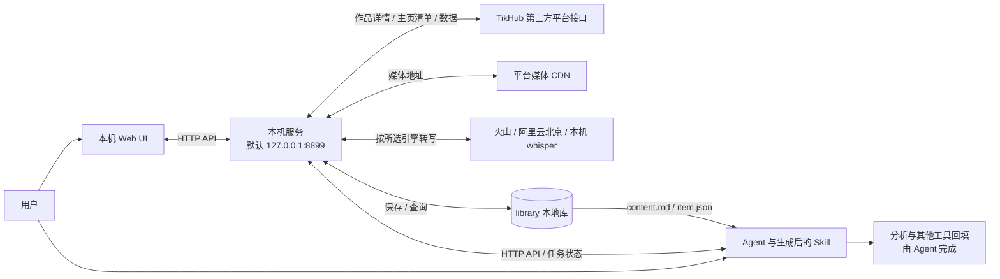
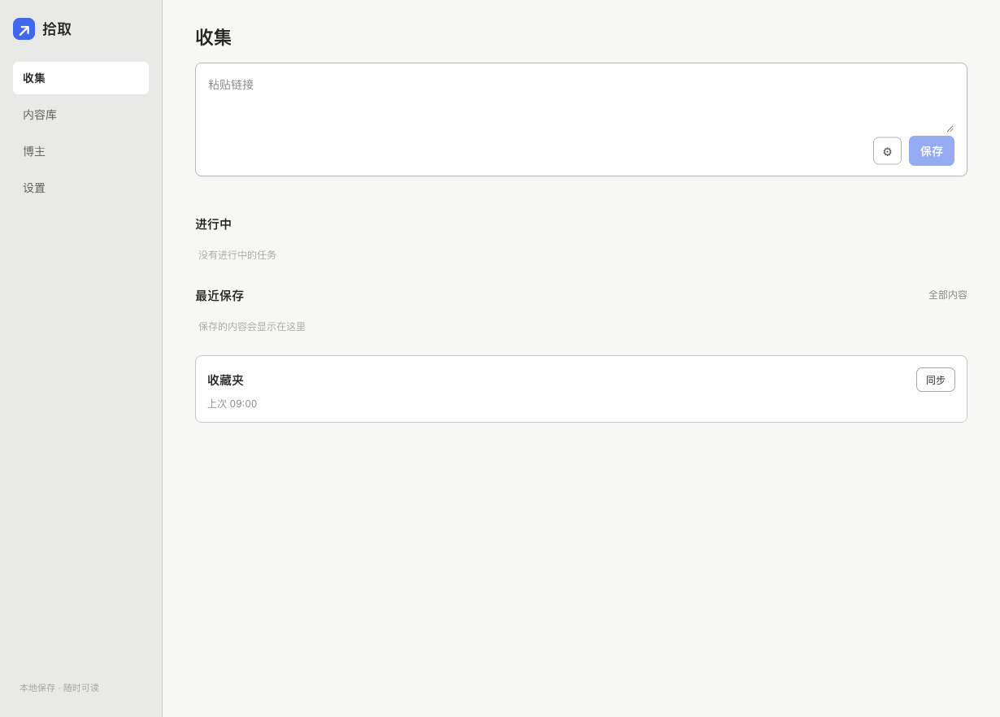
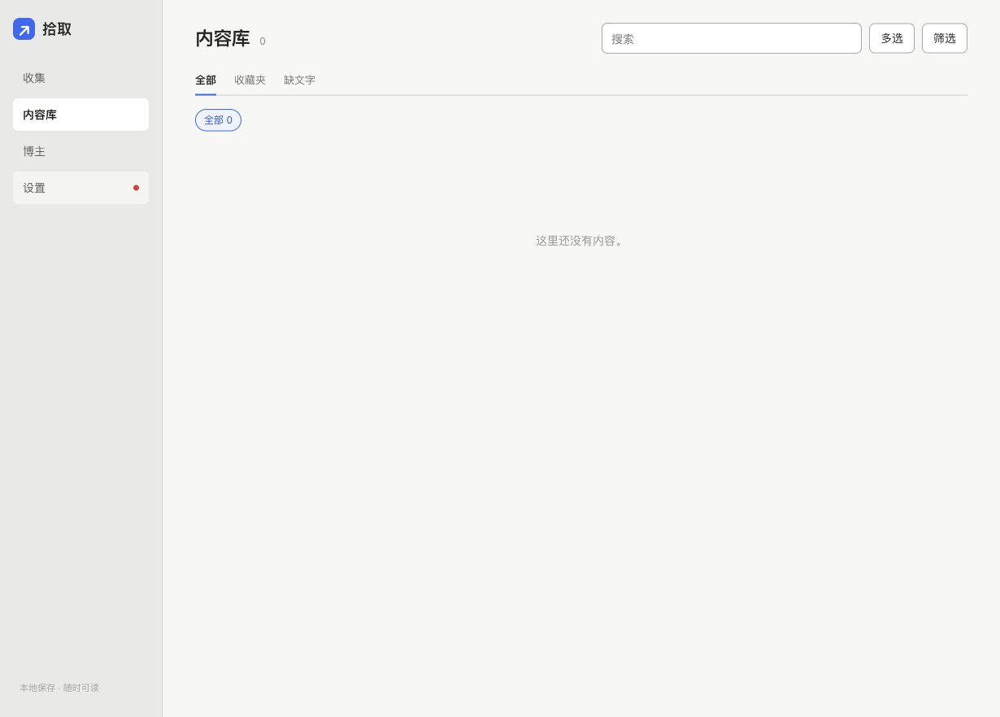
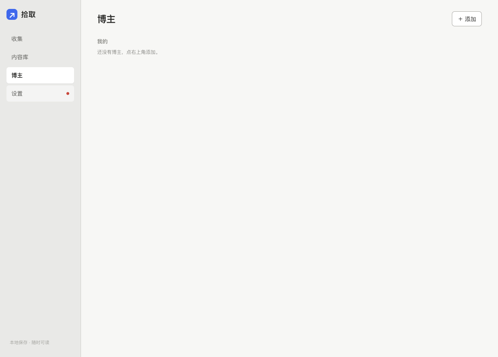
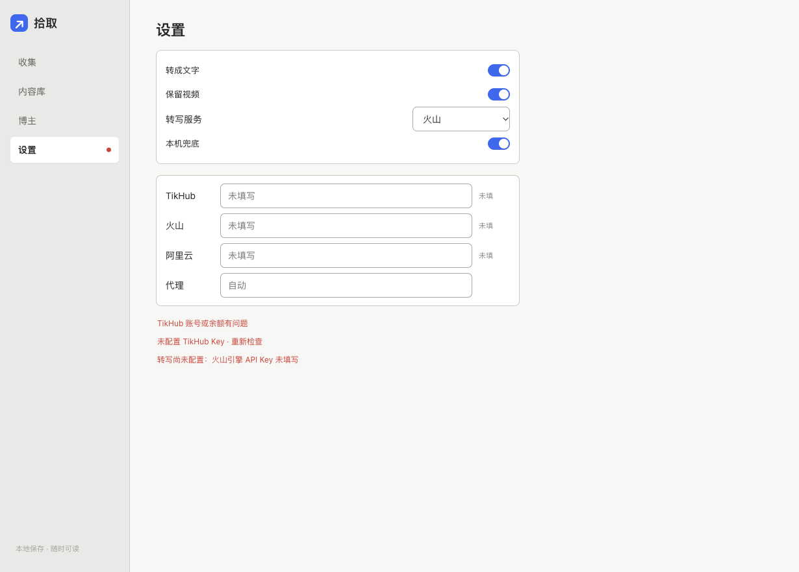
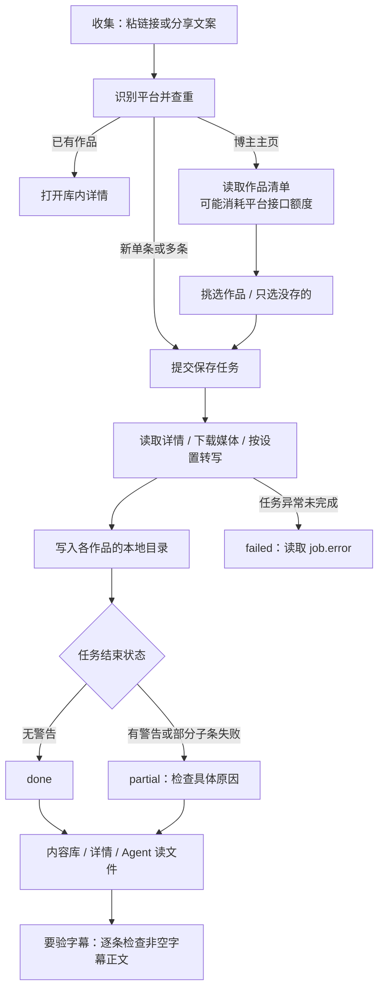

# 拾取 · 现有功能总览

> 盘点日期：2026-10-28。基于 `docs/feature-map` 的代码基准 `949ef4b1e3f7dcdd27be78c0356c32a2666399a6`，`VERSION` 为 `1.0.0`。这是功能盘点，不是新功能方案或本轮付费抓取验收报告。

## 1. 一句话定位

**把内容链接变成本机可阅读、可追溯、可交给 Agent 的资料库：粘链接 → 保存正文、媒体与可用文字稿 → 在网页里读，或让 Agent 读文件。**

| 你想做什么 | 从哪里进 | 现在的边界 |
|---|---|---|
| 保存一条作品、一次保存多条 | 网页「收集」；Agent 提交任务 | 重点支持抖音、小红书；平台数据接口有费用 |
| 从博主主页挑作品 | 「收集」粘主页，或「博主」查看作品 | 先取清单再勾选；预览也可能产生接口费用 |
| 把视频说的话变成文字 | 本次设置「转成文字」，或「设置」 | 要有可用引擎；入库成功不保证有字幕 |
| 找回内容、批量交给 AI | 「内容库」搜索、筛选、多选、复制给 AI | 复制的是本机文件路径，AI 必须能访问该机器 |
| 阅读正文、图片、视频、文字稿 | 点内容卡片进详情 | 视频需保留在本地；空稿会说明原因 |
| 查看版本更新 | Agent 调用 `/api/update` | 只提醒，用户同意后才升级 |

## 2. 架构总览



服务用 Python 标准库提供网页、JSON API、任务轮询、SSE 进度与媒体 Range 传输；媒体处理依赖 `ffmpeg`、`yt-dlp` 等命令。本机 whisper 需单独安装，不包含在“服务零 pip 依赖”的承诺中。

主流程由 `resolver` 抽链与识别，`jobs` 管任务，`fetcher` 编排，`adapters` 统一不同平台字段，`media` 下载和转写，`store` 落盘。**当前实际任务池为两个 worker**；批次内作品逐条处理。README 和 jobs 顶部的“串行队列”描述不能理解为全服务严格单任务。

## 3. 已支持平台与输入形态

### 重点支持与已有验收记录

| 平台 | 单条入口与内容 | 主页入口 | 证据范围 |
|---|---|---|---|
| 抖音 | `/video/<id>`、`/note/<id>`、分享文案与短链；`modal_id=` 识别为作品；另有文章适配 | `/user/<sec_uid>` | README/部署剧本记录有人声视频样例；重点支持作品与主页。文章入口有代码，不能据此宣称各类型均完成端到端验收 |
| 小红书 | `/explore/<id>`、`/discovery/item/<id>`、分享文案与短链；抓后判断图文或视频 | `/user/profile/<user_id>` | README/部署剧本记录有人声视频样例；视频 CDN HTTP 升 HTTPS 已合入 |

README 记录的有人声样例：抖音作品 `7401819680706448675`、小红书笔记 `6aad453b00000000110339cb`。这是既有记录；本轮没有重抓，不能保证平台链接和外部接口今天仍有效。

### 仅保留代码，未作完整验收

| 平台 | 代码识别与适配范围 | 需要特别区分 |
|---|---|---|
| X / Twitter | 帖子、图文、视频、文章及主页 | 不等于当前已稳定支持所有内容形态 |
| B 站 | BV/av 视频、UP 主空间 | 有专用适配器；不作完整可用承诺 |
| YouTube | 视频、短视频、频道 | 频道适配侧重长视频，不能当成所有 Shorts/直播清单 |
| 微博 | 帖子、视频/图片内容、主页 | 取决于外部接口数据 |
| 知乎 | 回答、文章、想法 | 主页能识别，但未注册专用主页适配，会走通用兜底 |
| 快手、TikTok | 视频、主页 | 代码保留，未作完整验收 |
| Instagram | 帖子、Reels、主页 | 混排图集内视频转写有明确缺口 |
| 微信公众号 | 单篇文章 | 无公众号主页批量入口 |
| 其他网址 | 通用 `yt-dlp` 兜底 | 能取多少取多少，不承诺任意网页完整抓取 |

`resolve` 从一段分享文案抽第一个 URL，必要时联网展开短链，不调用付费平台数据接口。Web 收集区可拆出多条链接并组成批次；**“链接识别”与“预览主页作品清单”是两个动作**，后者会用平台数据接口。短链展开失败、权限限制、私密内容、删除内容均可能阻断后续流程。

主页预览请求上限为 200 条；“加载更多”是扩大本次清单数量，不能理解为不限量拉全账号。缓存清单可以先看，刷新才重新请求。

## 4. Web UI：从哪进入、得到什么

以下四张是本轮真实本地页面截图，直接保存于 `docs/assets/`。截图实例为 `127.0.0.1:8898`，使用空库、空配置，禁用对外连接，没有填 Key、提交任务或下载媒体。设置页提示反映这个未配置的隔离实例，不代表用户原服务故障；截图中的“上次”文字也不能用作真实同步记录。

### 收集：入库入口与主页预览



- 粘单条、多条链接或分享文案；识别已保存作品，避免再次提交。
- 齿轮控制本次「转成文字」「保留视频」；转写未配置时有提示。
- 主页进入内联预览：封面、标题、时长和数据；勾选、只选没存的、刷新、加载更多，再保存选中作品。
- 首页展示进行中任务、最近保存；任务失败和批次部分失败有提示。任务在后端运行，关闭页面不影响进程内任务。
- 收藏夹「同步」入口保留，但公开仓没有附带同步脚本，见第 9 节。

预览没有真实截图：本轮不调用付费接口，也不填充模拟作品。预览能力依据 `web/index.html`、`web/app.js` 和服务代码盘点。

### 内容库：寻找、筛选与交给 AI



入口 `#/library`。有「全部 / 收藏夹 / 缺文字」页签，标题/作者/正文搜索，平台、博主、分组筛选，博主快捷筛选、分页加载。列表排除主页清单，展示具体内容。

卡片可进入详情；多选后「复制给 AI」或删除。按当前筛选复制全部会继续分页取齐，不只复制已加载的一屏。复制内容主要是 `content.md` 路径与标题，不会在拾取内启动 AI 分析。删除会删除本地条目目录，无回收站入口。

### 博主：登记与更新作品



入口 `#/accounts`，页面名称是「博主」，后端模型叫 accounts。支持添加抖音/小红书主页、显示名修改、移除登记；这不是平台登录或 cookie 管理。

展开博主可先读缓存作品，再「更新作品」请求新清单，合并本地已保存状态；可只选没存的、勾选作品保存。移除登记不删除已经入库的作品。当前是手动更新，没有定时追更调度。

### 设置：转写、视频保留与凭证状态



入口 `#/settings`。可开关转写、保留视频、本机兜底，选择火山/阿里云/本机，填写三个服务凭证及代理；修改后保存。凭证输入为密码框，读取配置接口只回“是否已配”，不回明文。环境变量优先于本地配置。

默认配置目录 `~/.glean`，可由 `GLEAN_CONFIG_DIR` 改；配置文件权限为 600。网页不是所有底层配置项的完整编辑器，部分选项仅配置/API 可设。

### 详情：阅读与追溯

从内容卡片进入 `#/item/<id>`：正文、图片、本地视频、文字稿分开呈现。字幕有时间戳时，可点时间定位并播放本地视频；视频没保留就无法执行这个跳转。

右上角「复制给 AI」提供文件引用；更多菜单支持复制正文、复制文字稿、打开原链接、打开文件夹、查看接口原始记录。没有字幕会显示 `transcript.note`，并汇总缺文件、缺文字等完整性说明。打开文件夹在 macOS 使用访达，其他系统返回路径。

**暂无真实详情截图**：隔离库为空，本轮没有真抓或伪造条目，以上以代码与下图为准。



## 5. HTTP API 能力表

下面按 `server/main.py` 的实际分派列出全部 API。`<id>`、`<job_id>`、`<account_id>` 是路径参数；静态页面由 `GET /`、`/app.js`、`/style.css` 等提供，前端 hash 路由不是额外 HTTP API。

| 方法 | 路径 | 一句话用途与边界 |
|---|---|---|
| GET | `/api/status` | 服务、版本、库计数/体积、依赖、凭证存在性和探测状态；`ok` 只代表进程可用 |
| GET | `/api/update` | 只读查询公开仓新版；`?refresh=1` 绕过进程内缓存 |
| GET | `/api/config` | 读取配置与凭证存在布尔值，剔除三个 Key 明文 |
| POST | `/api/config` | 白名单更新配置/凭证；不回显 Key，可能触发网络重探测 |
| POST | `/api/recheck` | 重新探测代理与网络；不是抓取或字幕验收 |
| POST | `/api/resolve` | 抽链、识别平台/类型/ID，返回 `already_in_library` 查重结果 |
| POST | `/api/preview` | 创建只读主页清单任务；不下媒体、不转写，但会请求平台数据并保存主页清单 |
| POST | `/api/jobs` | 创建单条或 `items` 批次抓取任务，返回 `job_id` |
| GET | `/api/jobs` | 最近任务列表，当前默认最多返回 20 条 |
| GET | `/api/jobs/<job_id>` | 查询 `job.state`、进度、warnings、错误和结果 ID |
| GET | `/api/jobs/<job_id>/events` | SSE 进度、渐进内容和结束事件 |
| GET | `/api/accounts` | 博主登记与摘要；返回支持抖音/小红书 |
| POST | `/api/accounts` | 添加主页登记，可指定显示名 |
| PATCH | `/api/accounts/<account_id>` | 修改显示名或主页 URL；网页只提供改名入口 |
| DELETE | `/api/accounts/<account_id>` | 移除登记，不删作品库 |
| GET | `/api/accounts/<account_id>/works` | 缓存作品清单与本地已有作品合并结果 |
| POST | `/api/accounts/<account_id>/sync` | 创建更新清单的预览任务；不等于自动把全部作品抓下来 |
| GET | `/api/items` | 分页查询条目、筛选与统计 |
| GET | `/api/items/<id>` | 完整结构化条目 |
| GET | `/api/items/<id>/content` | 读取 `content.md`，包装为 JSON 的 `content` 字段 |
| GET | `/api/items/<id>/raw` | 读取已保存的原始接口 JSON |
| DELETE | `/api/items/<id>` | 删除本地条目目录并重建索引 |
| POST | `/api/reveal` | 打开本地条目目录；非 macOS 返回路径 |
| GET | `/api/media/<id>/<filename>` | 提供本地媒体文件，支持 Range 播放 |
| GET | `/api/thumb` | 远程封面代理，参数 `url`、可选 `ref`/`w`；会联网 |
| GET | `/api/avatar` | 抖音/小红书白名单 HTTPS 头像代理与内存缓存；会联网 |
| GET | `/api/favorites/status` | 读取外置收藏同步脚本进度并核验进程；没脚本时未配置 |
| POST | `/api/favorites/sync` | 启动已配置的外置脚本；公开仓单独部署不具备完整同步能力 |

`/api/items` 支持 `platform`、`kind`、`exclude_kind`、`source`、`collection`、`q`、`author`、`author_id`、`missing_transcript=1`、`limit`、`offset`、`order`。每页最多 200 条；缺文字和作者过滤在分页前计算。返回总数及平台、作者、来源、收藏分组计数；不提供标签热度查询。

`/api/jobs` 支持媒体下载、是否转写、视频保留、主页展开/子条转写、来源与分组等选项；引擎由服务配置决定。任务记录在内存，服务重启后不恢复；超出历史阈值时淘汰已结束任务，没有取消/暂停 API。

`/api/update` 依次尝试 GitHub 最新 Release、Tag、main 的 `VERSION`，总超时预算 4 秒。成功缓存 6 小时、失败缓存 60 秒，返回 `current`、`latest`、`notes`、`update_available`、`source`、`error` 等；不会拉代码或重启服务。版本检查失败不阻断抓取。

## 6. 转写引擎与空稿契约

### 实际选择规则

| 设置 | 实际行为 | 准备条件 |
|---|---|---|
| `volcengine`（默认） | 火山录音文件极速版 | 对应 Key 与服务权限 |
| `aliyun` | 阿里云百炼异步文件转写 | 北京地域 Key，默认 filetrans 模型 |
| `local` | 本机 faster-whisper | 独立 Python 环境、模型和处理时间 |
| `off` | 引擎关闭，不生成转写 | 无需转写凭证 |

**不是“火山失败就自动试阿里云再试本机”。** 用户选定一个主引擎；云端故障且开启 `transcribe_fallback_local`、本机环境可用时才兜底到本机，并写明实际来源和原因。无有效语音、无音轨属于内容结果，不应反复换引擎重跑。

README 架构图写了“平台字幕优先”，但当前抖音、小红书适配直接走选定 ASR；通用适配器在转写没有结果后才尝试平台字幕。`media.fetch_subtitles` 能力存在，不代表主平台字幕优先已经落地。

### 状态不能混为一谈

| 状态/证据 | 能说明什么 | 不能说明什么 |
|---|---|---|
| `/api/status` 的 `ok: true` | 本机服务在响应 | Key 鉴权、余额或转写一定通过 |
| `queued` / `running` | 等待 / 执行中 | 已经完成入库 |
| `done` | 任务正常结束且无 warnings | 所有模式都有字幕；预览或不转写也可 done |
| `partial` | 任务结束但有 warnings，可已保存内容 | 可以忽略缺字幕、子条失败 |
| `failed` | 任务异常未完成，查 `job.error` | 所有已写文件一定不存在 |
| `content.md` 非空「字幕原文」 | 确有可读字幕正文 | 每句已人工校对无误 |

请求转写的视频没有有效文字时，统一补充 `transcript.note` 与 warnings，使任务以 `partial` 结束；原因包括引擎关闭、未配 Key、下载失败、音频提取/转写故障、没有有效语音。显式 `transcribe: false` 表示本次不要求字幕，不按空稿判验收失败。

网页会展示空稿原因；纯音乐/没有说话是正常内容结果，不要作为转写故障重抓。有人声样例的验收要求：`content.md` 的「## 字幕原文」有正文，同时 `item.json` 的 `transcript.text`、`segments` 非空，`source` 不是 `none`。

批次 `children_ok` 计入库数，子条 `has_transcript` 只是提示；要逐个 `item_id` 读文件，不能用主页清单替代字幕验收。重抓空稿时存储层会保留已有旧文字稿，并明确提示来源于上次结果。

视频默认保留；关闭「保留视频」时，在拿到有效文字后才清理视频文件，媒体记录标记 `removed`。未拿到文字时不应把这个开关理解为“立刻删除全部视频”。

## 7. Agent Skill 怎么用

部署入口是根目录 [AGENTS.md](../AGENTS.md)：检查依赖 → 用户自己填凭证 → 选择转写方式 → 启动 → 服务自检 → 经同意后使用有人声样例验字幕。服务默认只监听 `127.0.0.1:8899`。macOS 提供可选 launchd 自启；Linux 手动启动已写入文档，没有附带 systemd 单元。Windows 建议 WSL，直接使用 PowerShell 需按部署剧本运行 Python 服务。

[examples/SKILL.md](../examples/SKILL.md) 是模板，应先在仓库根目录生成：

```bash
python3 tools/render_skill.py \
  --host http://127.0.0.1:8899 \
  --root "$PWD" \
  --output ./generated/glean/SKILL.md
```

库在其他目录时加 `--library-dir`；交给另一台机器上的 Agent 时加 `--machine-label`，并确保命令在服务所在机器执行。已有输出默认不覆盖。生成后按部署剧本安装到相应 Agent 的 Skill 目录，不要直接复制未替换的模板。

抓取入口：用户把链接交给 Agent → 先 resolve 查重 → 单条提交 jobs，主页先 preview 供用户挑 → 轮询 `job.state` → 逐条验结果 → 返回 `content.md` 路径，再基于原文分析。不要绕过服务直接调用第三方，也不要把 Key 发进聊天。

版本提醒只需一句：**✨ 拾取有新版本啦：`x` → `y`，主要新增：……。要我帮你更新吗？** 不贴发布页链接；没有 notes 就省略新增说明，等用户同意后才更新。

## 8. 本地库结构

```text
library/                         # 可用 GLEAN_LIBRARY_DIR 改位置
├── AGENTS.md                    # 给 Agent 的读库规则
├── index.json                   # 程序列表索引，可重建
├── index.md                     # 人可读目录，可重建
└── items/<platform-kind-id>/     # 内容真源，按稳定 ID 组织
    ├── content.md               # 元数据、正文、标签、字幕、媒体与说明
    ├── item.json                # 结构化完整记录、时间轴、统计、warnings
    ├── transcript.srt           # 有字幕分段时才生成
    ├── raw/<endpoint>.json      # 原始接口返回，追溯出处
    └── media/                   # 实际下载的封面、图片、视频
```

Agent 先读索引找条目，再读 `content.md`；需要时间轴、实际引擎、媒体状态再查 `item.json`。主页条目存作品索引，子作品各有自己的目录。原文不改写；话题标签拆出后保留 `tags`，原始文案保存在 `text_raw`，文章不套用相同拆分。

同一作品查重与稳定 ID 减少重复目录；重抓会更新该条目，不是版本历史系统。索引可重建；已下载媒体路径和旧字幕有保留逻辑，主页子条“本地已有”按磁盘事实修正。配置与博主登记分别存在配置目录的 `config.json`、`accounts.json`，不在内容库内。

## 9. 明确还没有 / 不做

| 项目 | 现状与边界 | 对照依据 |
|---|---|---|
| 登录态 / cookie / 客户端解密抓取 | 开源版不包含；不负责平台账号登录和私密内容绕过 | README「已移除」 |
| 收藏夹全自动同步 | UI/API 和来源、分组字段保留；同步依赖外置脚本，公开仓未附带，不能开箱即用 | main 的 favorites 路由、配置默认路径、SPEC §4.6–4.7 |
| 分析、改写、发布、飞书回填 | 拾取不做；由 Agent 和其他工具负责 | README / SPEC 定位 |
| 抖音、小红书平台字幕优先 | 尚未落地主流程；目前由选定 ASR 处理 | 两个平台转写调用与 generic 的字幕分支 |
| 标签热度、话题排行榜 | 有标签提取与保存，没有热度计算、聚合榜单或对应页面/API | fetcher / store / web / main |
| Mac 双击安装器 | 本次盘点按“暂缓”处理；现有 shell 启停和 launchd 脚本，不能等同图形安装器 | 仓库现状；“暂缓”为本次任务给定背景，仓内没有排期承诺 |
| 所有平台、所有类型完整验收 | 没有；识别、适配器注册、成功入库、字幕完整是不同层级 | README 支持范围、resolver / adapters |
| 无限主页拉全与定时追更 | 预览最多 200 条；博主手动更新，没有定时调度 | main / jobs / web |
| 持久任务、断点续跑、取消暂停 | 任务在进程内存；关网页可继续，重启服务不能恢复任务 | jobs / main 路由 |
| 库内编辑、字幕校对、回收站 | 当前页面没有这些入口；删除直接作用于本地条目 | web / store |
| 自动升级 | 没有；更新接口只读，Skill 先提醒再等同意 | update_check / examples/SKILL.md |

以上是范围说明，不代表已经确定下一步要开发哪项。本轮没有改动这些行为。

## 10. 最近已合 PR 背景

此处覆盖 #1–#6 范围内本分支历史可确认的五个合入 PR；**#3 不在已合清单内，不补写其内容或状态**。

| PR | 已合内容 | 对现状的影响 |
|---|---|---|
| [#1](https://github.com/ijijEas0n/glean/pull/1) | 小红书视频 CDN HTTP 升 HTTPS | 改善视频下载链路 |
| [#2](https://github.com/ijijEas0n/glean/pull/2) | 冷启动文档、Linux 与 Skill | 部署与 Agent 接入步骤更完整 |
| [#4](https://github.com/ijijEas0n/glean/pull/4) | 转写结果契约、空稿原因展示 | 不把入库成功误报成字幕成功 |
| [#5](https://github.com/ijijEas0n/glean/pull/5) | 用户路径 B1–B11 修复 | 涉及丢图、重复保存、空稿与提示等 |
| [#6](https://github.com/ijijEas0n/glean/pull/6) | `/api/update` 与 Skill 提醒 | Agent 可查新版，用户确认后升级 |

PR 背景根据本分支 git 合入历史与当前代码整理，本轮没有操作其他 PR。

## 11. 本轮核对范围

已对照 [README](../README.md)、[SPEC](../SPEC.md)、[部署剧本](../AGENTS.md)、[Skill 模板](../examples/SKILL.md)、[VERSION](../VERSION)，以及 `server/main.py` 全部路由、`update_check.py`、`store.py`、`jobs.py`、`resolver.py`、`fetcher.py`、各平台适配器、媒体/配置/账号模块和 `web/` 页面脚本样式。

本轮验证的是代码现状和隔离实例的真实空页面。没有调用付费接口、云转写或真媒体下载，没有完成新的抓取端到端验收，也没有使用模拟数据冒充抓取结果。截图服务结束后关闭；既有服务、真实配置和真实内容库均不改动。
